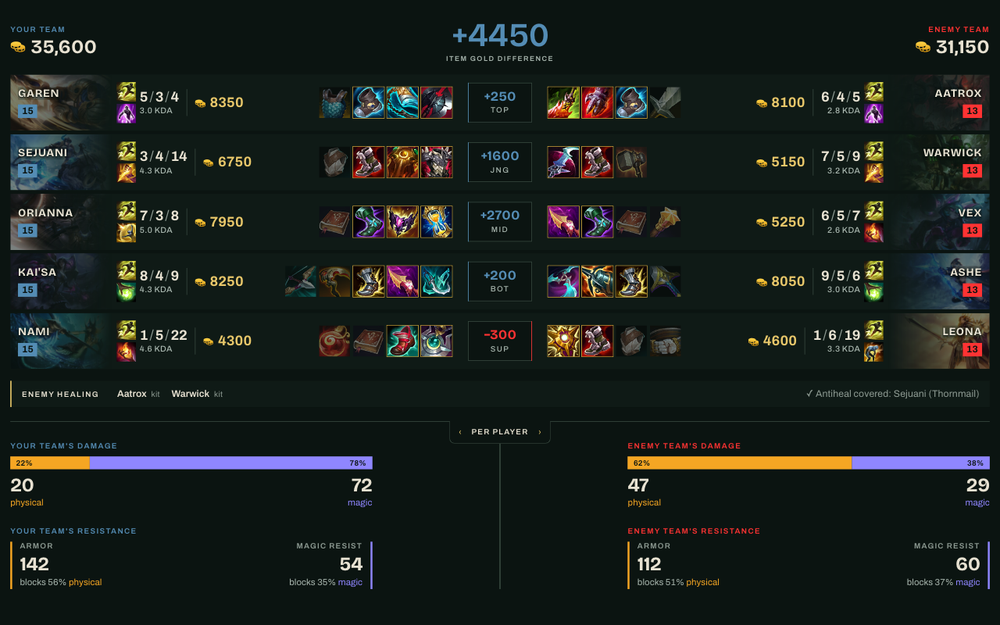
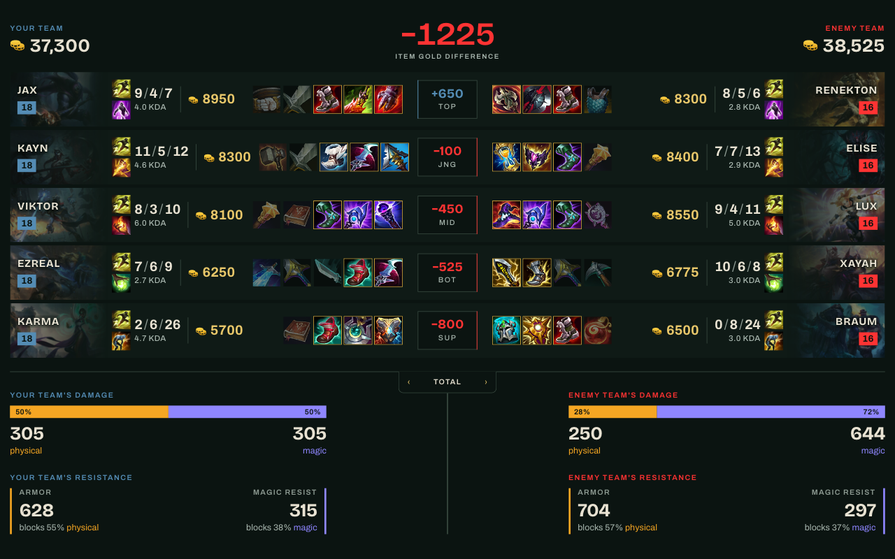

  

<h1 align="center">Goldline - Live Stats for LoL</h1>

  Live stats for your current League of Legends match, in a browser tab next to the game.

  <!-- TODO: replace PLACEHOLDER with the real store IDs once the listings are live -->
  <a href="https://chromewebstore.google.com/detail/goldline/PLACEHOLDER"><b>Chrome Web Store</b></a>
  &nbsp;·&nbsp;
  <a href="https://addons.mozilla.org/firefox/addon/PLACEHOLDER/"><b>Firefox Add-ons</b></a>
   
  Chrome Web Store: also Edge, Brave, Opera

  

## What it shows

- **Item gold:** the total value of the items each side has bought, and the difference between the teams. Unspent gold isn't counted.
- **Lane matchups:** each player lined up against their lane opponent, with KDA, CS, items and summoner spells.
- **Enemy damage and resistance:** damage dealt, shown per player or as a team total, alongside armor and magic resist.
- **Healing:** how much healing each side is getting.
- **Summoner spell timers:** cooldown timers for each player's summoner spells.

Damage and resistance can be switched between per-player averages and team totals:

  

## Install

**From the stores:** use the Chrome Web Store or Firefox Add-ons links above. The Chrome Web Store version also installs in other Chromium browsers such as Edge and Brave.

**From source:**

- **Chrome and other Chromium browsers:** open `chrome://extensions`, turn on Developer mode, choose **Load unpacked** and select the `extension/` folder.
- **Firefox:** open `about:debugging#/runtime/this-firefox`, choose **Load Temporary Add-on** and select `extension/manifest.json`. Temporary add-ons are removed when Firefox closes. Firefox 140 or newer is required.

## Use

1. Click the Goldline icon in your browser. A new tab opens with a **Waiting for a game** screen.
2. Start a match. The loading screen counts.
3. The first time, your browser will warn you that the connection isn't private. Open **Setup and connection help** on the waiting screen and follow the steps: open the link, click **Advanced**, then **Proceed to 127.0.0.1 (unsafe)**.
4. Return to the Goldline tab. It connects on its own within a few seconds and the live stats appear.

If Goldline stops connecting later, repeat step 3.

### Why the browser warning?

Goldline reads your match data from the League of Legends client, which serves it from your own computer at `127.0.0.1` while you play. The client uses a certificate your browser doesn't recognize, so it shows a warning. Accepting it once lets Goldline connect. It only applies to that local address.

## Privacy

Goldline has no accounts, analytics or tracking, and it sends nothing to the developer. It reads match data from the game client on your own computer (`https://127.0.0.1:2999`) and downloads public game data and images from Riot's Data Dragon (`ddragon.leagueoflegends.com`). Full details are in [PRIVACY.md](PRIVACY.md).

## Build

`./package.sh` writes `dist/goldline-chrome.zip` and `dist/goldline-firefox.zip` for store upload. The two builds differ only in their manifest. It needs `jq` and `zip`.

## License

MIT, see [LICENSE](LICENSE). Third-party notices are in [THIRD_PARTY.md](THIRD_PARTY.md).

---

Goldline - Live Stats for LoL isn't endorsed by Riot Games and doesn't reflect the views or opinions of Riot Games or anyone officially involved in producing or managing Riot Games properties. Riot Games and all associated properties are trademarks or registered trademarks of Riot Games, Inc.
